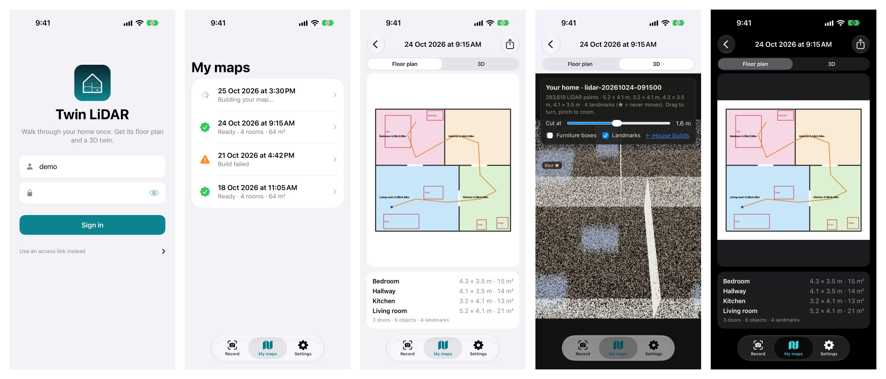
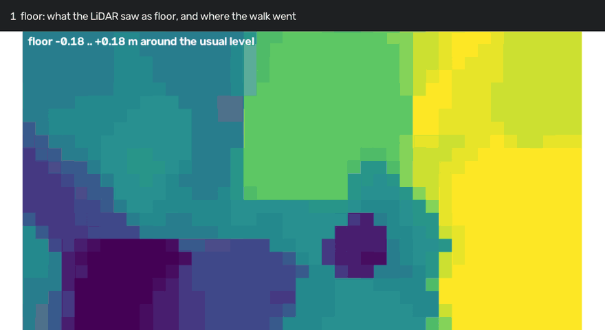
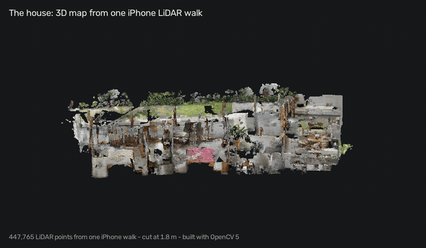
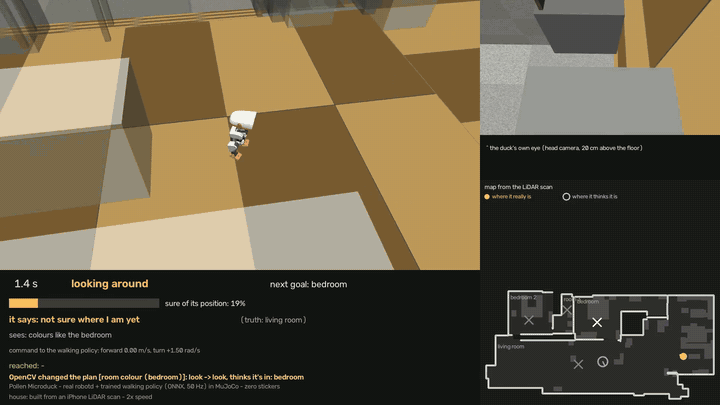

# House Twin Patrol: the complete demo

An iPhone LiDAR walk of a home becomes a digital twin (floor plan, rooms, doors, 3D) built with OpenCV 5. A small
robot, Pollen's Microduck, then patrols that home with **zero stickers**. It knows where it is from its 8×8 depth sensor
and the twin, checks itself with OpenCV on its own camera, and asks a person when it is unsure.

```
iPhone app ──upload──► server builds the twin (OpenCV 5) ──house.json──► the duck's brain
  record a walk           floor → walls → doors → rooms        self-location (ToF + map)
  sign in, My maps        3D view, floor plan                  OpenCV on the camera → decisions → a person's OK
```


*The agent loop on the live walk, real values from its trace: the 8×8 ToF zones, how sure it is, what it thinks vs what
the camera's colours say, and the moments OpenCV changed the plan or the duck asked a person (yellow edges).*


Contest category: **Agentic Vision**. The checklist with evidence is in [section 6](#6-agentic-vision-evidence).

## Quick start
Judges: [TESTING.md](TESTING.md) tests everything without the iPhone app (a built sample home is in `samples/`).
```
scripts/demo.sh offline              # on samples/synth-multi: self-location, camera test, fast tests (1 min)
scripts/demo.sh live [house] [--ask] # live walk on Pollen's duck-sim with the camera, then the film
scripts/demo.sh server               # the app's server locally (API_KEY, TOKEN_SECRET, APP_PASSWORD_HASH)
scripts/demo.sh app                  # generate and open the Xcode project (app)
```

## 0. Setup (once)
- `uv` and Python 3.12. Every command runs with OpenCV 5: `--with opencv-python-headless==5.0.0.93`.
- Live robot demo: Pollen's duck-sim (`~/Pollen/microduck`, `~/Pollen/microduck_rl`) with the scanned house as its
  MuJoCo scene, gstreamer for the camera (`brew install gstreamer libnice-gstreamer`).
- iPhone with LiDAR (12 Pro or later) for the app. See `app/README.md`.

All commands below run from the repo root.

## 1. The app: from a walk to a map
The iPhone app (`app`, SwiftUI) records RGB, LiDAR depth and the ARKit pose while you walk, uploads it, and
shows your maps once the server has built them. Build and server setup: `app/README.md`.



1. **Sign in** with the demo account; the session lasts 30 days on this phone.
2. **Record.** Tap the zone you are in, then **Start recording**. Sweep every wall, do a slow duck-height turn and tag
   fixed objects. Tap **Doorway** and the new zone when you change room, then **Stop**.
3. **Check and review.** The recording check scores zones, low views, tags and size; **Review zones & tags** fixes
   room boundaries and tag labels.
4. **Upload**, then **Watch it build**.
5. **My maps** lists every walk with its state and updates by itself; a notification says when one is ready.
6. **Open the map:** the floor plan (pinch to zoom, room sizes, share) and the **3D** point cloud with landmarks.
7. A failed build has **Build again**; a phone without LiDAR still opens My maps; Settings has **Sign out**.

Server side: `POST /auth/login` gives a signed token (30 days, HMAC-SHA256, scrypt password hash, 5 failed tries per
10 min); every endpoint takes it or the old key; `GET /lidar/maps` lists maps with their state. Tests:
`uv run --python 3.12 --with-requirements service/requirements.txt --with pytest --with httpx python -m pytest service/test_auth.py -q`.
The screenshots (all nine in `app/screenshots/`) are the Xcode build in the iOS Simulator, showing a synthetic
flat.

## 2. The twin: how the map is built
```
uv run --python 3.12 --with opencv-python-headless==5.0.0.93 python lidar/pipeline/build_house.py <session>.zip
```




Four OpenCV stages (`twin/plan/`), each leaving a picture (`stage_walls.png`, `stage_doors.png`, `stage_rooms.png`):

| stage | OpenCV 5 | what it finds |
|---|---|---|
| floor | `circle` | where the walk went, what LiDAR saw as floor |
| walls | `morphologyEx`, `dilate`, `HoughLinesP`, `line` | vertical surfaces spanning 1 m of height; glass bridged by Hough lines |
| doors | (on the wall runs) | 0.55–1.3 m openings with floor on both sides |
| rooms | `connectedComponents`, `floodFill`, `findContours`, `approxPolyDP`, `fillPoly` | the floor with doors shut falls apart into rooms |
| the duck's map | `distanceTransform`, `morphologyEx` | distance to the nearest wall: fast ray casts, route clearance |

Before the stages: TSDF fusion of the depth frames (`cv.Volume` HashTSDF) and normals (`RgbdNormals`) in
`twin/fuse.py`; object labels with `dnn.readNet` in `twin/classify.py`. Output: `out/houses/<session>/house.json`
(rooms, doors, walls, furniture, occupancy).

## 3. Where am I? Self-location
`agent/loc/` (one module per job), run by `agent/localize.py`:
1. **ToF read:** the two level rows of the 8×8 sensor, only rows that measured.
2. **Spin match:** not sure yet → turn once on the spot; the 360° scan is matched against every free spot of the map at
   every heading (coarse 20 cm, then 10 cm). A match is clear only when the best place beats the next one by a margin.
3. **Fit check:** verify before trusting: from the estimate, do the measured zones fit the map? Weak fit → not sure
   (look around); only a fresh fit may declare arrival.
4. **Jump check:** once trusted, a new estimate more than 1 m + 10 % of the walk away is a false positive; the guesses
   near the trusted pose stay the answer.

Try it (any house, both sensors, several seeds; green/red against the old filter):
```
uv run --python 3.12 --with mujoco --with opencv-python-headless==5.0.0.93 python eval/selfloc.py \
  --variants base,spin+rowfix+range+fit+relook+jump --seeds 8
```

| 22 houses × 4 seeds | old filter | new filter |
|---|---|---|
| runs that locked onto a wrong place (sim / rough sensor) | 63 / 89 of 96 | 1 / 3 of 96 |
| false arrivals | 10 / 56 | 0 / 0 |
| goals reached | 82 % / 51 % | 94 % / 94 % |

## 4. The agent loop: OpenCV changes what the duck does
Five times a second: sense → locate → see → decide → act (diagram: `agent/README.md`).
- **See:** OpenCV 5 on the head camera frame (`cvtColor`, `inRange`, `calcHist`): which room do these colours look
  like? A vote for that room goes into the filter (`update_room`).
- **Notice:** if the frame changed the decision (look ↔ go, the room it believes it's in, or where the route starts),
  a `vision_decision` event is logged and the route is planned again from the corrected guess.
- **Ask:** two moments where a person decides (`--ask` on the terminal; default auto-yes, logged):
  - lost for 20 s on one goal: "Keep looking for the bedroom?" No → it stops.
  - at the goal, if the camera's colours over the last 5 s name another room: "I think I'm in the bedroom, but the
    camera's colours say kitchen. Say I've arrived?" No → not declared, it checks again in 10 s.

Offline, in the twin with rendered camera frames:
```
uv run --python 3.12 --with mujoco --with opencv-python-headless==5.0.0.93 python eval/vision_walk.py --seeds 16 [--decline]
```

## 5. Live: the real robot software on the twin
Pollen's real `robotd`, `tofd` and trained walking policy drive the simulated body in the MuJoCo twin of the scanned
house. Our brain only sends velocity commands and reads odometry, the ToF and the camera; no true pose, no stickers.
```
cd ~/Pollen/microduck && DUCK_SIM_SCENE=~/Pollen/microduck_rl/src/mjlab_microduck/robot/microduck/scene_myhouse.xml DUCK_SIM_CAMERAS=a DUCK_SIM_VIEWER=0 scripts/duck-sim
cd <repo>
uv run --python 3.12 --with numpy python -m agent.duck_recorder --out out/walk/<house> &      # flight recorder for the film
uv run --python 3.12 --with mujoco --with opencv-python-headless==5.0.0.93 python -m agent.walk \
  --house out/houses/<house> --goals bedroom,bedroom_2,room_3,living_room --no-standin --ask
uv run --python 3.12 --with mujoco --with opencv-python-headless==5.0.0.93 python -m agent.film --house out/houses/<house> --speed 2
```


`summary.json` has `camera: true`, `vision_decisions` and `approvals`; `grep -E 'vision_decision|approval' trace.jsonl`
shows each one. The film shows the chase camera, the duck's own eye, the map (truth vs belief) and the brain in words,
with a banner whenever the camera changed the plan or the duck asked a person.

| live walk, 4 rooms | old filter | new filter, ToF + camera |
|---|---|---|
| rooms reached | 4/4 | 4/4 |
| until sure and right | 61 s | 7.8 s |
| time sure but more than 50 cm off | 17.7 % | 0 % |
| right room when sure | 98.5 % | 98.7 % |
| whole walk | 351 s | 427 s (stops to look when it can't verify itself) |
| camera: decisions changed / questions asked | – | 4 / 2 |

## 6. Agentic Vision evidence
| the rule asks for | where |
|---|---|
| an agent in a multi-step perception → decision → action loop | `agent/walk.py` (live), `eval/vision_walk.py` (offline); diagram in `agent/README.md` |
| OpenCV 5 tools in that loop | `agent/perceive.py`: `cvtColor`, `inRange`, `calcHist` (room colour); ArUco + `solvePnPGeneric` optional (`--stickers`) |
| image results influence a plan, an action or a request for human approval | `vision_decision` events re-plan the route; the camera's colour vote at a goal triggers "Say I've arrived?" |
| human approval and failure handling | `approval` events; declined → stop (lost) or check again (arrival) |
| a trace showing vision changing a decision | `out/walk/<house>/trace.jsonl`, e.g. `{"event": "vision_decision", "cause": "room colour (room_3)", "before": {"mode": "go", "room": "bedroom_2", …}, "after": {"mode": "go", "room": "room_3", …}}` |

## 7. A 5-minute video (3-minute cut with full voice-over: [docs/VIDEO_SCRIPT.md](docs/VIDEO_SCRIPT.md))
| time | show | say |
|---|---|---|
| 0:00–0:40 | the app: sign in, record a walk with zone taps, upload | "One walk with an iPhone is all the setup." |
| 0:40–1:20 | My maps: building → ready; floor plan and 3D | "OpenCV 5 turns the walk into a floor plan: walls, doors, rooms." |
| 1:20–1:50 | `twin/plan` stage pictures | "Four stages, each a few OpenCV calls." |
| 1:50–3:30 | live film (2×, `out/walk/<house>/walk_2x.mp4`): spin, "sure", walking, banners; `docs/agent_loop.gif` as the loop overlay | "Pollen's real robot software walks the duck; our brain only steers. It turns once to find itself, checks every belief against the depth sensor, and the camera's OpenCV checks change its decisions." |
| 3:30–4:10 | an approval moment in the trace / terminal | "When it's unsure, it asks." |
| 4:10–5:00 | results tables and the limits below | "What works, what doesn't yet." |

## 8. Limits (honest)
- **Room colour is a weak sense live:** single live frames name the right room 46 % of the time (75 % in the twin);
  the fingerprints come from the twin's renders, not the head camera. A 5 s vote was right at all 4 live arrivals.
- **Rooms that look alike to the ToF**, and glass walls it sees through, can still give a wrong *first* match (4 of
  192 sandbox runs); camera place recognition would be the fix.
- **The live test is a simulation:** real robot software and walking policy, simulated body, sensors and house.
- **The walking policy can fall** while turning on the spot (once, in an earlier version that turned much more).
- **Objects:** the detector can't recognise the twin's plain boxes, so objects are off live (`--no-standin`).
- **Camera cost:** brain time per step goes from 20 to 57 ms with the camera on.
- **The app:** one shared account sees every map; recording and upload were tested on the phone before today's
  changes, the new screens only in the simulator.

## 9. Where things are
- Explanations (local, not in the repo): `reports/map_flow.html`, `reports/selfloc_explained.html`,
  `reports/selfloc_vs_agentic.html`.
- Change notes: `.claude/*.md`.
- Outputs (gitignored): `out/houses/`, `out/walk/`, `out/selfloc/`, `out/vision/`.
