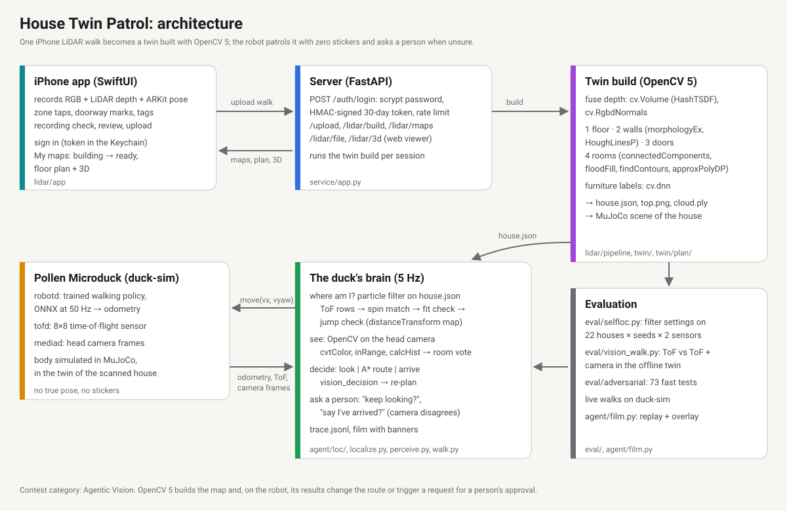

# House Twin Patrol: technical report

OpenCV AI Competition 2026 · path: **Agentic Vision with OpenCV 5** (not COOL) · repo: https://github.com/laughtt/house-twin-patrol

## Team
- **Team name:** Jose Mauricio Carpio (solo entry)
- **Jose Mauricio Carpio**: design, code, home scans, robot integration, evaluation. *Past hackathons and competitions:
  (to add).*

## 1. Problem and real-world impact
Home robots get lost in real homes. Every home is different, robots can't practise in yours before they arrive, and
the usual fixes (stickers on the walls, beacons, a long mapping run by the robot itself) are what people don't want to
do. Small robots like Pollen's Microduck (shipping end of 2026) have only an 8×8 depth sensor and a small camera.

House Twin Patrol turns **one walk with an iPhone** into a digital twin of the home (floor plan, rooms, doors, 3D), and
gives the robot a brain that patrols that home **with zero stickers**: it finds itself, goes to each room, checks
itself with OpenCV on its own camera, and asks a person when it is unsure.

Impact: a robot that knows "this is the bedroom" from day one can do check-in rounds for someone living alone, go to
a named room on request, or watch for problems, without the owner mapping or marking anything. The same twin lets
robot developers test in a copy of a real home before shipping.

## 2. Users and beneficiaries
- People living alone or with reduced mobility, and their families: a home robot that can do rounds and reach a named
  room reliably.
- Owners of small home robots (Microduck and similar) who won't put markers on their walls.
- Robot developers who need realistic homes to test in (the twin is a MuJoCo scene of the scanned home).

## 3. Architecture


1. **iPhone app** (`app`, SwiftUI): records RGB, LiDAR depth and the ARKit pose with room taps; sign in; upload;
   My maps (building → ready, floor plan, 3D).
2. **Server on AWS** (`service/`, `infra/`): FastAPI behind Caddy (HTTPS) on EC2 Graviton4; login with signed tokens;
   runs the twin build for each upload.
3. **Twin build** (`lidar/pipeline`, `twin/`): OpenCV 5 turns the walk into `house.json`, a floor plan and a 3D cloud,
   and a MuJoCo scene of the home.
4. **The duck's brain** (`agent/`): the agent loop below, 5 times a second.
5. **The robot**: Pollen's real robot software (`robotd` with its trained walking policy, `tofd`, `mediad`) driving a
   simulated body in the MuJoCo twin. The brain only sees odometry, the 8×8 ToF and the camera.

### The agent loop (Agentic Vision)


| step | what happens | code |
|---|---|---|
| sense | odometry, 8×8 ToF frame, head-camera frame | `agent/walk.py` |
| locate | particle filter on the twin: ToF rows → spin match (a full turn matched against every place and heading) → fit check (do the zones fit the map from the estimate?) → jump check (a far jump from the trusted pose is a false positive) | `agent/loc/`, `agent/localize.py` |
| see | OpenCV 5 on the frame: HSV histogram → which room the colours look like → a vote in the filter | `agent/perceive.py` |
| notice | if the frame changed the decision (look ↔ go, the believed room, the route start), log `vision_decision` and re-plan | `agent/walk.py` |
| decide | look around / follow an A* route / declare arrival | `agent/walk.py`, `agent/loop.py` |
| ask | lost 20 s → "keep looking?"; at a goal where the camera's colours name another room → "say I've arrived?" | `agent/walk.py` |
| act | velocity command to the walking policy | `agent/duck_rpc.py` |

Workflow diagram and trace format: `agent/README.md`.

## 4. OpenCV 5 implementation
| where | OpenCV 5 | for |
|---|---|---|
| depth fusion | `cv.Volume` (HashTSDF), `cv.RgbdNormals` | fuse the LiDAR frames into one cloud with normals |
| floor | `cv.circle` | the walk's footprint |
| walls | `cv.morphologyEx`, `cv.dilate`, `cv.HoughLinesP`, `cv.line` | vertical surfaces 1 m tall, glass bridged by Hough lines |
| rooms | `cv.connectedComponents`, `cv.floodFill`, `cv.findContours`, `cv.approxPolyDP`, `cv.fillPoly` | the floor with doors shut falls apart into rooms |
| landmarks | `cv.dnn.readNet` (CLIP, ImageNet classifier) | what each candidate object is, whether it moves |
| the duck's map | `cv.distanceTransform` | distance to the nearest wall: fast ray casts, route clearance |
| the duck's eye | `cv.cvtColor`, `cv.inRange`, `cv.calcHist` | room colour vote each frame |
| optional | ArUco `detectMarkers`, `cv.solvePnPGeneric` (IPPE) | marker fixes (`--stickers`), off by default |
| demo assets | `cv.VideoWriter`, drawing | the film, GIFs, app icon |

Pinned: `opencv-python-headless==5.0.0.93` (`requirements.lock`, `service/requirements.lock`).

## 5. AWS deployment
| component | service | notes |
|---|---|---|
| server | **EC2 Graviton4** (Arm), c8g.xlarge, us-east-1 | FastAPI under systemd (`infra/twin.service`), Caddy auto-HTTPS (`infra/Caddyfile`) at `game.adtomic.co` |
| twin build | same instance | OpenCV 5 (aarch64 wheels) runs the full build per upload |
| language model | **Amazon Bedrock** (Claude) | the markerless room-measure agent (`service/v0`); IAM instance role allowing Claude models only (`infra/bedrock-*.json`, `infra/bedrock-role.sh`) |
| auth | in the app server | scrypt password hash, HMAC-SHA256 30-day tokens, rate limit on failed logins (`service/app.py`, `service/test_auth.py`) |

Not used (yet): S3 for uploads (they stay on the instance disk), autoscaling, CloudWatch dashboards. COOL was not
pursued: the build runs on stock OpenCV 5 on Graviton, with no COOL baseline measured.

**Judge access** (step by step, no iPhone needed: [TESTING.md](TESTING.md)): web endpoint `https://game.adtomic.co` (app login: user `judge`, password in the submission form);
code and instructions in this repo; a live screen-share of the robot walk on request.

## 6. Build, deploy, test
```
scripts/demo.sh offline              # on samples/synth-multi: self-location, camera test, fast tests (1 min)
scripts/demo.sh live [house] [--ask] # live walk on Pollen's duck-sim with the camera, then the film
scripts/demo.sh server               # the server locally
scripts/demo.sh app                  # the Xcode project
```
Dependencies: `requirements.lock` (sim, brain, eval), `service/requirements.lock` (server), XcodeGen `project.yml`
(app). Server deploy and the judge account: `app/README.md`. Full walkthrough: `DEMO.md`.

## 7. Evaluation
**Self-location, 22 houses × 4 seeds × 2 sensors** (`eval/selfloc.py`; "rough" = 2.5 m range, 20 % dropped zones):

| | old filter (sim / rough) | final (sim / rough) |
|---|---|---|
| runs that locked onto a wrong place | 63 / 89 of 96 | 1 / 3 of 96 |
| false arrivals | 10 / 56 | 0 / 0 |
| goals reached | 82 % / 51 % | 94 % / 94 % |
| bumps | 803 / 1390 | 267 / 305 |

**Live, Pollen's robot software in the twin, 4 rooms, zero stickers, ToF + camera only** (`out/walk/<house>/`):

| | old filter | final |
|---|---|---|
| rooms reached | 4/4 | 4/4 |
| until sure and right | 61 s | 7.8 s |
| time sure but more than 50 cm off | 17.7 % | 0 % |
| right room when sure | 98.5 % | 98.7 % |
| distance from goal at arrival | – | 13–30 cm |
| camera decisions changed / questions asked | – | 4 / 2 |

**Camera in the offline twin** (`eval/vision_walk.py`, 16 starts × 3 goals): 48/48 goals with ToF alone and with the
camera; 16 decisions changed by the camera; at arrival the 5 s colour vote names the true room 45 of 48 times; with a
person who always says no, 5 questions and still 48/48 (the check passes later).

**Fast tests:** 72 of 73 adversarial tests pass (`eval/adversarial`).

**Observability:** every step and event is in `trace.jsonl`; `agent/film.py` replays it with the chase camera, the
duck's eye, the map (truth vs belief) and banners for vision decisions and questions (`docs/robot_walk.gif`).

## 8. Failure cases and limitations
- **Live-only failures found and fixed:** the walking policy sways ~58 cm a turn (the spin scan restarted every turn);
  stale fit history threw away a correct match; head wobble; walking pitches the head so the ToF hits the floor. A first
  version of the jump check reset and re-turned on every jump; live, it got lost for ~150 s and the walking policy fell
  over (dropped).
- **Rooms that look alike to the ToF**, and glass walls it sees through, can still give a wrong *first* match (4 of
  192 sandbox runs); the one failing fast test is a pair of twin rooms told apart only by a TV. Camera place recognition
  would be the fix.
- **The camera's room vote is weak live:** 46 % of single frames right (75 % in the twin): the colour fingerprints come
  from the twin's renders, not the head camera.
- **Markers:** ending the spin match on an ArUco sighting cost goals (48 → 32 of 48); markers are off by default.
- **Simulated body:** the robot software and walking policy are real; the body, sensors and house are simulated.
- **Camera cost:** brain time per step goes from 20 to 57 ms with the camera.
- **One shared account** on the server; uploads stay on one instance.

## 9. Responsible use
- **Privacy:** home scans are private by default: uploads are behind the login, raw frames and recordings are never in
  the repo (`data/`, `out/` are git-ignored). The images in this repo are renders of the author's own home, shared by
  choice; they show no people.
- **Human control:** the robot asks before going on when lost, and before claiming an arrival the camera disagrees
  with; a "no" stops it or makes it check again. Every decision and answer is logged.
- **Safety:** slow speeds (the brain asks for at most 0.25 m/s; the walking policy covers about 40 % of that), creeping
  through doors, backing off after a bump.
- **Licences:** Pollen's Microduck meshes (CC BY-NC-SA 4.0) and model weights are not redistributed; the robot software
  is Pollen's, used as is. Credit to Pollen Robotics.
- **AI assistance:** parts of the code were written with an AI coding assistant (Claude Code); the agentic workflow
  claimed here is the robot's own loop, not the coding assistant.
