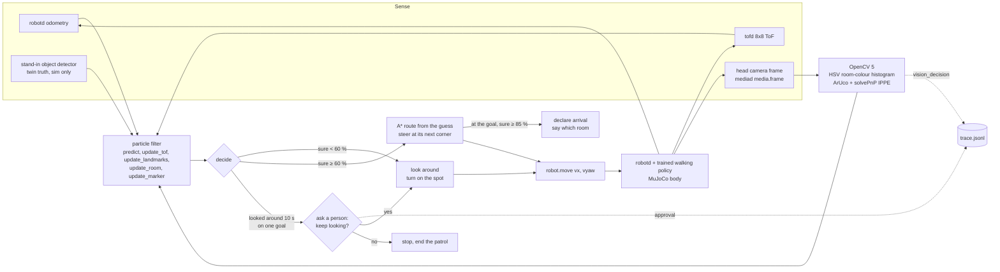

# The duck's agent loop

Five times a second the duck senses, updates where it thinks it is, decides, and moves. OpenCV 5 reads the duck's
own head-camera frames. What it sees changes the filter's guess, and the next route is planned from that guess. When
the duck stays unsure, it asks a person before it carries on.



- `perceive.py`: OpenCV on a frame. `see(pf, bgr, K)` feeds the room colour and every map marker within 3 m
  into the filter.
- `localize.py`: the particle filter. `loop.py`: A* routes and following a route.
- `walk.py`: the live loop on Pollen's duck-sim. `mission.py`: the same brain in the offline twin, without a camera.
- `../eval/vision_walk.py`: the brain in the offline twin, with frames rendered by the twin and the same
  `vision_decision` and approval logic as `walk.py`.

## Trace events (`trace.jsonl`)
Each step has one line: `t`, `true`, `est`, `conf`, `mode`, `aim`, `goal`, `room_said`, `room_true`, `seen`
(objects plus `aruco N`), `colour` (the room the camera's colours look most like), and so on. Event lines add `event`:

- `vision_decision`: one camera frame changed what the brain does. That can be looking around versus acting on its
  guess, the room it believes it is in, or (by 30 cm or more) where its route starts from. `before` is the decision
  without that frame, `after` is the decision with it. The route is then planned again from `after`. Example from
  `eval/vision_walk.py` (seed 4): the duck was 4.2 m off and looking around; ArUco 3 put it 16 cm from the truth and
  it set off.
  ```json
  {"t": 1.2, "event": "vision_decision", "cause": "aruco 3",
   "before": {"mode": "look", "room": "kitchen", "est": [1.125, 1.465, -0.756], "conf": 0.38, "aim": null},
   "after": {"mode": "go", "room": "living_room", "est": [2.673, 5.309, 0.777], "conf": 1.0, "aim": [2.51, 4.95]},
   "goal": "living_room", "true": [2.83, 5.35, 0.791]}
  ```
- `approval`: the duck asked a person. `answer` is true or false. `by` is `auto` (the default: yes, logged),
  `terminal` (`--ask`) or `script` (in the eval). When the answer is no, the duck stops and the goal ends with
  `why: "declined"`.
  ```json
  {"t": 68.6, "event": "approval", "question": "Lost for 10 s (42% sure, best guess: living_room, the camera's colours say: kitchen). Keep looking for the living_room?", "answer": true, "by": "script"}
  ```
- `arrive`: the duck says it reached the goal (`true_dist` is how far off it really was).

## Does the camera change the outcome? (offline twin, 16 starts, 3 goals each)
`uv run --python 3.12 --with mujoco --with opencv-python-headless==5.0.0.93 python eval/vision_walk.py --seeds 16 [...]`

| setup | goals reached: ToF / ToF + camera | located itself (median s) | vision decisions |
|---|---|---|---|
| markers on 3 walls, no object detector | 28/48 / 36/48 | 13/16 (11.6 s) / 16/16 (4.8 s) | 147 |
| `--zero-stickers` (room colour only) | 34/48 / 37/48 | 14/16 (15.4 s) / 16/16 (5.6 s) | 72 |
| `--standin` (plus the stand-in detector) | 45/48 / 47/48 | 16/16 (5.7 s) / 16/16 (7.1 s) | 39 |
| `--decline` (the person says no) | 23/48 / 25/48 | 5 patrols stopped after asking | 106 |

The marker plates also change what the ToF rays hit, so the ToF-only column moves between setups by a few goals. That
is the noise level of 16 starts.

## Live (Pollen's duck-sim)
The camera needs `DUCK_SIM_CAMERAS=a`, and the ArUco plates have to be in the scene. `python -m twin sim
out/current/house.json --spawn <x,y,heading>` puts them there; `--no-markers` leaves them out, which is the
zero-sticker scene. Without a camera, `walk.py` says so and runs on ToF and the stand-in detector.
