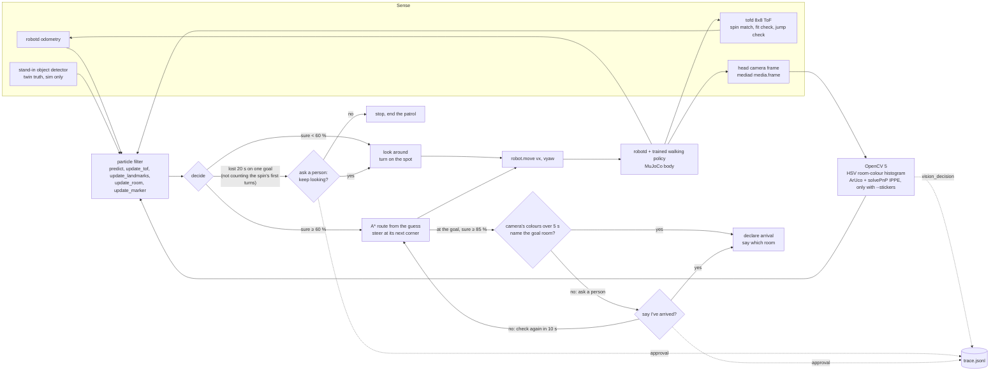

# The duck's agent loop

Five times a second the duck senses, updates where it thinks it is, decides, and moves. OpenCV 5 reads the duck's
own head-camera frames (zero stickers: the room's colours). What it sees changes the filter's guess, and the next route
is planned from that guess. When the duck stays unsure, or the camera disagrees that it has arrived, it asks a person.



- `perceive.py`: OpenCV on a frame. `see(pf, bgr, K)` feeds the room colour and every map marker within 3 m
  into the filter.
- `localize.py`: the particle filter. `loop.py`: A* routes and following a route.
- `walk.py`: the live loop on Pollen's duck-sim. `mission.py`: the same brain in the offline twin, without a camera.
- `../eval/vision_walk.py`: the brain in the offline twin, with frames rendered by the twin and the same
  `vision_decision` and approval logic as `walk.py`.

## Trace events (`trace.jsonl`)
Each step has one line: `t`, `true`, `est`, `conf`, `mode`, `aim`, `goal`, `room_said`, `room_true`, `seen`
(objects plus `aruco N`), `colour` (the room the camera's colours look most like), and so on. Event lines add `event`:

- `vision_decision`: one camera frame changed what the brain does. That can be looking around versus acting on its
  guess, the room it believes it is in, or (by 30 cm or more) where its route starts from. `before` is the decision
  without that frame, `after` is the decision with it. The route is then planned again from `after`. Example from
  `eval/vision_walk.py` (seed 4): the duck was 4.2 m off and looking around; ArUco 3 put it 16 cm from the truth and
  it set off.
  ```json
  {"t": 1.2, "event": "vision_decision", "cause": "aruco 3",
   "before": {"mode": "look", "room": "kitchen", "est": [1.125, 1.465, -0.756], "conf": 0.38, "aim": null},
   "after": {"mode": "go", "room": "living_room", "est": [2.673, 5.309, 0.777], "conf": 1.0, "aim": [2.51, 4.95]},
   "goal": "living_room", "true": [2.83, 5.35, 0.791]}
  ```
- `approval`: the duck asked a person. Two moments: lost for 20 s on one goal ("keep looking?"; declined, the duck
  stops and the goal ends with `why: "declined"`), and at the goal when the camera's colours over the last 5 s name
  another room (`cause: "room colour"`, "say I've arrived?"; declined, it checks again in 10 s). `answer` is true or
  false; `by` is `auto` (the default: yes, logged), `terminal` (`--ask`) or `script` (in the eval).
  ```json
  {"t": 135.95, "event": "approval", "question": "Lost for 20 s (50% sure, best guess: living_room, the camera's colours say: bedroom). Keep looking for the bedroom_2?", "answer": true, "by": "auto", "goal": "bedroom_2"}
  ```
- `arrive`: the duck says it reached the goal (`true_dist` is how far off it really was).

## Does the camera change the outcome? (offline twin of the flat, 16 starts, 3 goals each)
`uv run --python 3.12 --with mujoco --with opencv-python-headless==5.0.0.93 python eval/vision_walk.py --seeds 16 [--stickers] [--standin] [--decline]`

With the self-location filter (spin match, fit check, jump check) the ToF alone already finds itself every time here,
so the camera can't add goals; what it adds is the room it names and the checks a person is asked about.

| setup | goals: ToF / ToF + camera | found itself | vision decisions | questions asked |
|---|---|---|---|---|
| zero stickers (default: room colour only) | 48/48 / 48/48 | 16/16 / 16/16 (11 s) | 16 | 3 (arrival, colour disagreed) |
| zero stickers, the person says no | 48/48 / 48/48 | 16/16 / 16/16 | 15 | 5 (asked again, then agreed) |
| `--stickers` (ArUco on 3 walls) | 48/48 / 48/48 | 16/16 / 16/16 | 16 | 2 |
| `--standin` (plus the stand-in detector) | 48/48 / 48/48 | 16/16 / 16/16 | 28 | 2 |

On the old filter (before self-location) the camera mattered more: ToF 28/48 → camera 36/48 with markers, 34 → 37 with
colour only. Ending the spin match on an ArUco sighting was tried and dropped: IPPE's two poses are told apart by the
still-random guess (48 → 32 of 48). A single frame's colour names the true room 75 % of the time in the twin, a 5 s vote
at arrival 45 of 48.

## Live (Pollen's duck-sim, big house, 4 rooms, zero stickers, no stand-in: ToF + camera only)
`DUCK_SIM_CAMERAS=a scripts/duck-sim`, then `python -m agent.walk --house out/houses/<name> --no-standin [--ask]`.
Without a camera, `walk.py` says so and runs on ToF and the stand-in detector.

| live walk | ToF only | ToF + camera |
|---|---|---|
| rooms reached | 4/4 | 4/4 |
| until sure and right | 8.0 s | 7.8 s |
| sure but > 50 cm off | 0 % | 0 % |
| right room when sure | 97.9 % | 98.7 % |
| bumps | 1 | 3 |
| whole walk | 400 s | 427 s |
| brain per step | 20 ms | 57 ms (frame fetch + OpenCV) |
| vision decisions / questions | – | 4 / 2 ("keep looking?", auto-yes) |

Live frames name the true room only 46 % of the time (the colour fingerprints come from the twin's renders: other
lighting and field of view than the 45° head camera), mostly living room vs bedroom. At the 4 arrivals the 5 s vote was
right every time (living room 14 frames to 11).
