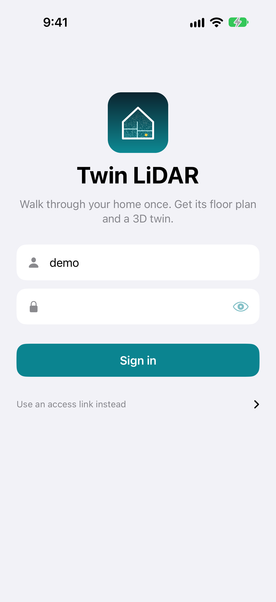
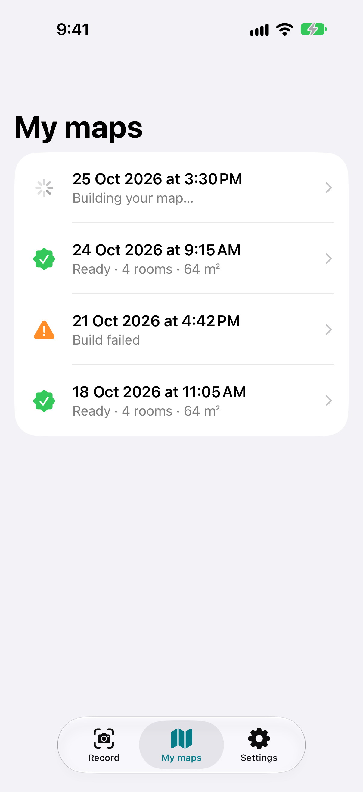
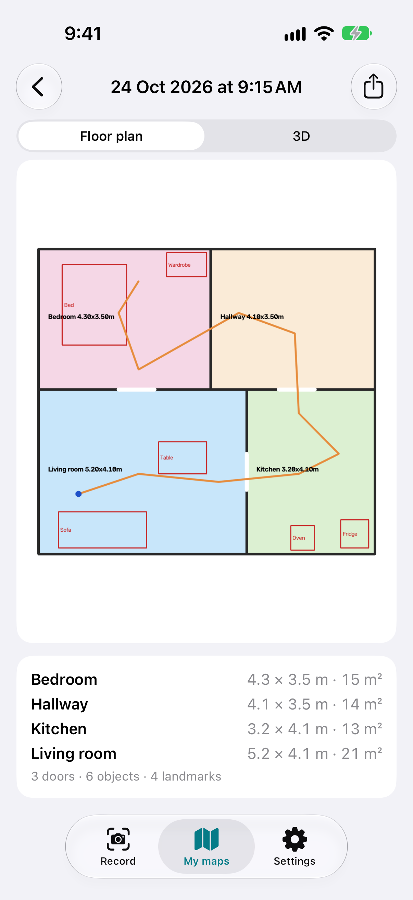
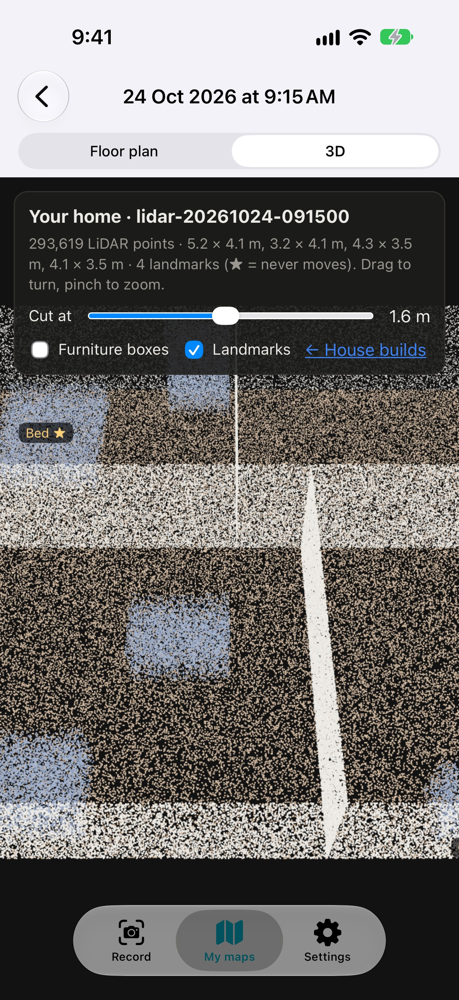

# Twin LiDAR app

Sign in, record a walk through the home (zones, doorways, tags, score card, review), upload, and open the finished
floor plan and 3D twin under **My maps**. Recording tips: `../lidar/README.md`.

| Sign in | My maps | Floor plan | 3D |
|---|---|---|---|
|  |  |  |  |

(Screenshots use a synthetic demo flat, no real home.)

## Build it yourself (any Mac with Xcode)
The Xcode project is in the repo, so nothing else is needed.
1. `git clone https://github.com/laughtt/house-twin-patrol`, then open `app/HouseTwinLidar.xcodeproj` in Xcode.
2. **Simulator** (no Apple account): pick an iPhone simulator and press **Run** (▶). Sign in with the judge account;
   the simulator has no LiDAR, so it shows My maps and the maps, not recording.
3. **Your iPhone** (a free Apple ID works): target **HouseTwinLidar** → **Signing & Capabilities** → *Automatically manage
   signing*, **Team** = your Apple ID, **Bundle Identifier** = something unique such as `io.<yourname>.twinlidar`.
   Plug the phone in, pick it as the destination, press **Run**. First time: turn on Developer Mode on the phone and
   trust your Apple ID (steps in `../lidar/README.md`). Recording needs an iPhone or iPad Pro with LiDAR.

From the command line (simulator, no signing):
```sh
cd app
xcodebuild -project HouseTwinLidar.xcodeproj -scheme HouseTwinLidar -sdk iphonesimulator \
  -destination 'generic/platform=iOS Simulator' CODE_SIGNING_ALLOWED=NO build
```

## Changing the project
```sh
brew install xcodegen && cd app && xcodegen generate   # regenerates HouseTwinLidar.xcodeproj from project.yml
```
- `project.yml` is the source of truth (the `.xcodeproj` is generated). Version: `MARKETING_VERSION`, build number:
  `CURRENT_PROJECT_VERSION` (bump it for every TestFlight upload).
- Server: build setting `SERVER_URL` (default `https://game.adtomic.co`, read from Info.plist `ServerURL`). App Transport
  Security stays on, so only HTTPS works, except a local `http://127.0.0.1:<port>` in the simulator for development:
  `xcodebuild … SERVER_URL=http://127.0.0.1:8790 build`.
- Icon and launch logo: `uv run --with opencv-python-headless python app/make_icon.py` redraws them.
- Recording needs a LiDAR iPhone/iPad Pro; on other devices and in the simulator the app still signs in and shows My maps.

## Sign and ship (TestFlight)
1. Xcode → target **HouseTwinLidar** → Signing & Capabilities: your team (`DEVELOPMENT_TEAM` in `project.yml`) and a
   bundle id you own (`PRODUCT_BUNDLE_IDENTIFIER`, now `io.housetwinpatrol.lidar.mc`).
2. App Store Connect → Apps → **+** → new iOS app with that bundle id.
3. Bump `CURRENT_PROJECT_VERSION`, `xcodegen generate`, then in Xcode pick *Any iOS Device* → Product → **Archive** →
   Distribute App → App Store Connect → Upload. Export compliance is answered in Info.plist
   (`ITSAppUsesNonExemptEncryption = NO`: only standard HTTPS).
4. App Store Connect → TestFlight → add internal testers (or a public link after beta review). Give testers the account
   below.

## Server: accounts and env
The service (`service/app.py`) reads:

| Variable | What |
|---|---|
| `API_KEY` | legacy shared key (old phone links `?k=…`, scripts); still accepted |
| `TOKEN_SECRET` | random secret that signs login tokens (HMAC-SHA256, 30 days), e.g. `python -c "import secrets; print(secrets.token_urlsafe(32))"` |
| `APP_USER` | the default account's user name (default `demo`) |
| `APP_PASSWORD_HASH` | `scrypt:<salt>:<hash>` of its password; empty = login disabled |

Create the default account (from `house-twin-patrol/`, prompts twice, prints the hash, never stores the password):
```sh
python -m service.passwd
```
Put the printed line in the server env file as `APP_PASSWORD_HASH=…` with `TOKEN_SECRET` and `APP_USER`, then restart the
service. Changing the password, the user or `TOKEN_SECRET` signs every phone out. Five wrong passwords from one address
lock login for 10 minutes. `GET /lidar/maps` lists every scan with its build state for the app.
Tests: `uv run --python 3.12 --with-requirements service/requirements.txt --with pytest --with httpx python -m pytest service/test_auth.py -q`.
